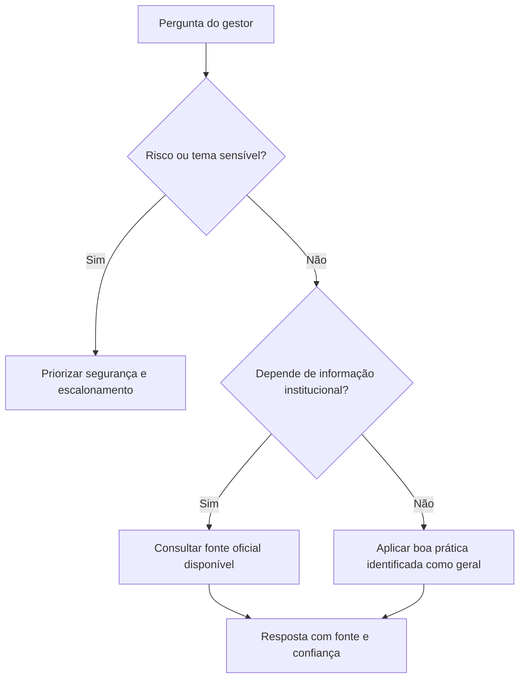

# Gestor Acolhe

Protótipo de agente corporativo de apoio à liderança, estruturado para orientar próximos passos seguros sem substituir áreas humanas responsáveis.

## Capacidades presentes no prompt

- Hierarquia de fontes e classificação de confiança.
- Orientação trilíngue em português, espanhol e inglês.
- Limites para temas médicos, jurídicos, disciplinares e éticos.
- Minimização de dados, proteção contra prompt injection documental e escalonamento humano.

## Arquitetura conceitual

## Limitações e status

Não substitui People & Performance, Saúde, Jurídico, Compliance ou emergência. A existência de recuperação automática de documentos não foi comprovada.

**Status:** prompt documentado. Testes públicos: **planejados — não executados**.

Veja a [versão pública do prompt](prompt/public-version.md).
