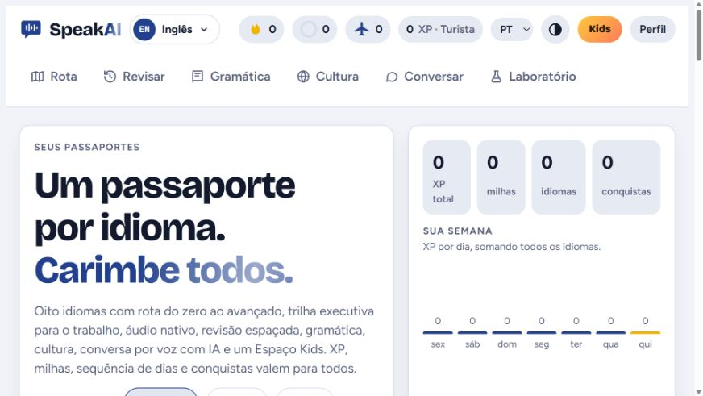
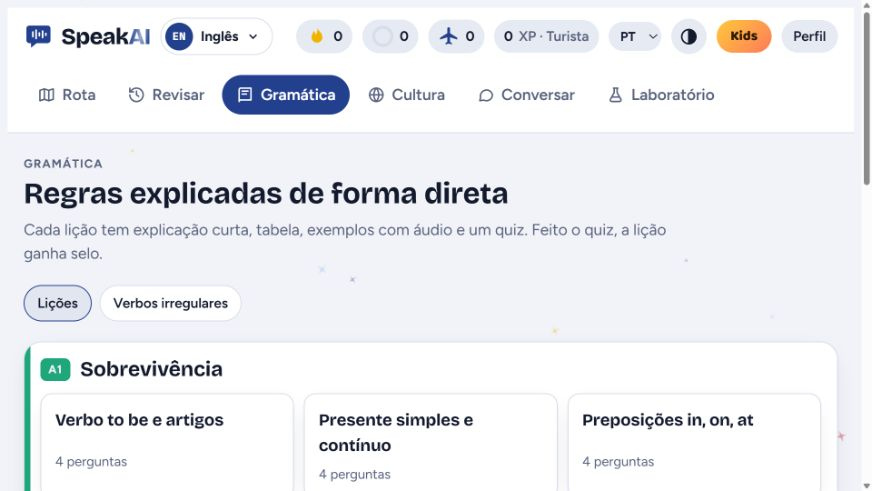

# SpeakAI

Protótipo de tutor conversacional para aprendizagem profissional de idiomas.

## Demonstração visual da aplicação local

Além do prompt documentado nesta pasta, esta galeria apresenta uma implementação local do SpeakAI, executada em 29/10/2026. As imagens mostram interfaces reais de seleção de idiomas, jornada de aprendizagem e gramática. O código completo está no repositório privado [speakai-projeto](https://github.com/matosluan93/speakai-projeto). A integração de conversação com IA não foi validada nesta sessão.

### Idiomas

### Jornada de inglês

### Gramática

## Capacidades presentes no prompt

- Modos de aula, prática, conversação, avaliação, revisão e plano de estudos.
- Adaptação conservadora ao nível QECR informado ou estimado.
- Orientação textual de pronúncia e análise de transcrições.
- Controle contra invenção de informações sobre o usuário.

## Limitações e status

Não há comprovação de áudio, avaliação acústica, memória persistente, certificação QECR ou acompanhamento real de progresso. XP e estado são conceituais.

**Status:** prompt documentado. Testes: **planejados — não executados**.

Veja a [versão pública do prompt](prompt/public-version.md).

