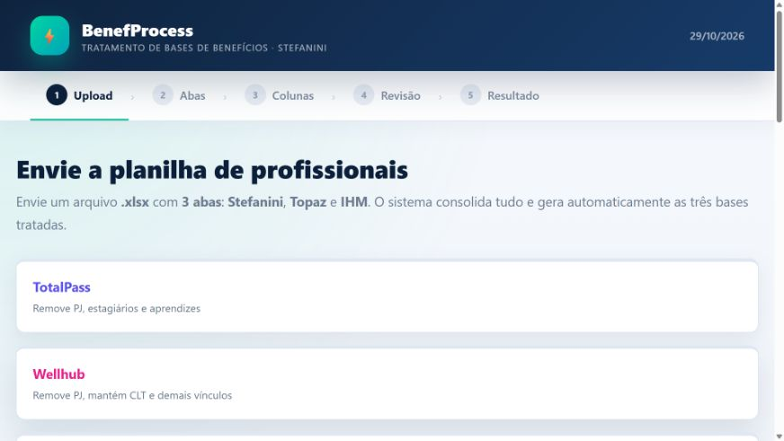
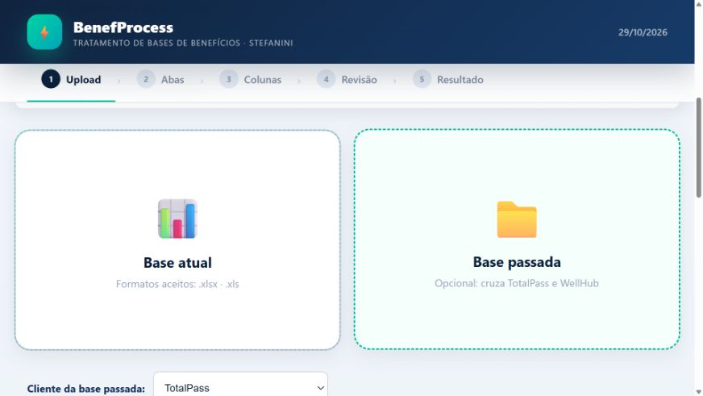

# BenefProcess

Aplicação web local em Python e Flask para tratamento, validação, auditoria e exportação de bases de benefícios.

## Demonstração visual

Capturas reais da aplicação em execução local, em 29/10/2026, sem carregar bases de colaboradores.

### Fluxo de tratamento de benefícios

### Importação de arquivos

## Funcionalidades confirmadas pela documentação e inventário

- Processamento local de planilhas.
- Aplicação de regras por fluxo.
- Validação e deduplicação de registros.
- Geração de Excel, CSV, ZIP e apresentações PowerPoint.
- Registro de exclusões para auditoria.

## Tecnologias declaradas

Python, Flask, pandas, openpyxl, xlsxwriter, python-pptx e lxml.

## Privacidade

Bases reais, arquivos enviados e saídas geradas permanecem fora do Git. A pasta temporária foi removida do repositório local e preservada em backup privado.

## Classificação

Aplicação de automação de dados; não deve ser apresentada como IA sem integração comprovada com modelo ou LLM.

Código: [matosluan93/benef-process](https://github.com/matosluan93/benef-process)

