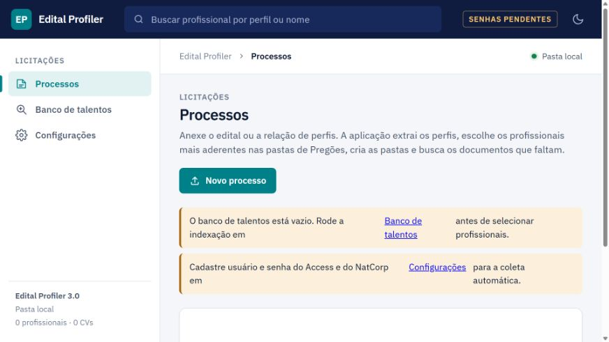

# Edital Profiler · Editais e organização documental

Aplicação web para estruturar os perfis de um edital, pesquisar informações em documentos e acompanhar a organização de profissionais e arquivos por processo.

**Projeto principal do portfólio.**

[Código completo — repositório privado](https://github.com/matosluan93/edital-profiler)

## Problema e solução

Centralizar um fluxo que envolve leitura de requisitos, consulta a documentos anteriores, acompanhamento de pendências e organização das entregas. A aplicação reúne processos, perfis, recuperação de contexto, critérios de comparação, pastas e uma planilha de controle.

## Tecnologias e conhecimentos

| Frente | Implementação |
| :--- | :--- |
| Backend e persistência | Python, Flask, Flask-SQLAlchemy e SQLite |
| Processamento documental | pdfplumber, pypdf, python-docx e openpyxl |
| Busca e análise | NumPy, índice local, recuperação de trechos e critérios de comparação |
| IA opcional | Chamada REST ao Groq para leitura assistida do edital |
| Armazenamento | Pasta local ou integração Microsoft Graph/OneDrive com MSAL |
| Automação de navegador | Playwright e roteiros de seletores para portais |
| Credenciais | Integração com keyring; teste do cofre em memória |
| Qualidade | pytest, testes de fluxo e documentos de exemplo gerados pela suíte |

## Demonstração visual

Interface em execução local, com armazenamento isolado e sem conexão com portais ou credenciais corporativas.

## Evidência de testes

Em **5 de novembro de 2026**, a suíte local do projeto registrou **3 testes aprovados** com `python -m pytest -q`. A execução usou Python, banco de teste, documentos gerados pela suíte e um cofre em memória.

- **Regras de documentos:** classificação de arquivos, normalização de nomes e identificação de senioridade.
- **Fluxo local:** indexação, leitura do edital, seleção por perfil, organização de arquivos, planilha de controle e registro de pendências.
- **Cofre de credenciais:** gravação, recuperação, exclusão e verificação de que a consulta de status omite a senha.

O fluxo verificado usa armazenamento local. Microsoft Graph, Groq e os portais corporativos ficaram fora desta execução.

## Estágio das integrações

O modo local pode ser avaliado com documentos de teste. Microsoft Graph, OneDrive e Groq dependem de configuração própria. O roteiro do NatCorp ainda exige confirmação de seletores; busca e download no Access aguardam mapeamento. A captura da interface e os testes locais não comprovam a operação desses portais.

[Todas as aplicações](../) · [Inventário técnico](../../SKILLS.md) · [Portfólio](../../README.md)
