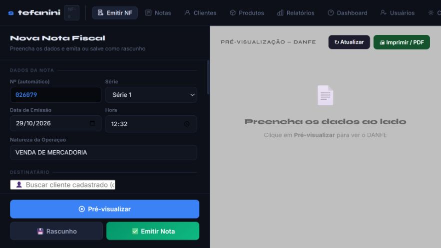
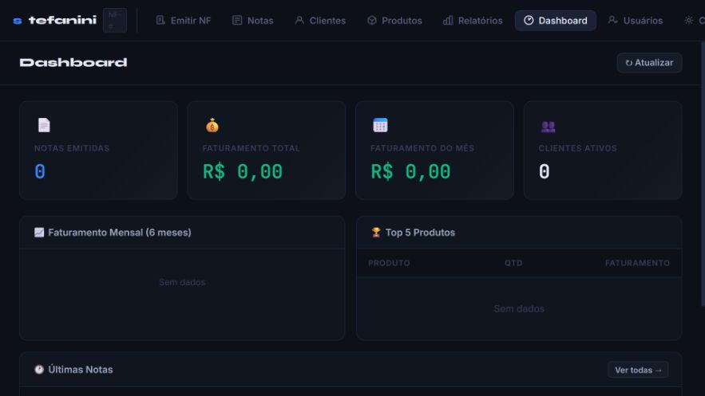

# NF-e — Automação

Protótipo web local para organizar dados de notas e apresentar uma interface inspirada em DANFE para controle interno.

## Demonstração visual

Capturas reais do protótipo em execução local, em 29/10/2026, com banco novo e vazio. O ambiente utiliza uma empresa de demonstração e não está conectado ao Bling ou à SEFAZ. As telas não comprovam emissão fiscal oficial.

### Cadastro e pré-visualização

### Painel de acompanhamento

## Funcionalidades confirmadas na versão local inventariada

- Backend Flask.
- Persistência local em SQLite.
- Interface em HTML, CSS e JavaScript.
- Cadastro e consulta local de registros e produtos.
- Numeração local e visualização para impressão.

## Limitações críticas

Não há comprovação de integração produtiva com SEFAZ, certificado digital, assinatura oficial de XML, autorização fiscal ou emissão de NF-e com validade jurídica. O banco local foi retirado do rastreamento e protegido por `.gitignore`.

## Status

Protótipo funcional para uso e demonstração local, não emissor fiscal de produção.

Código: [matosluan93/nfe_system_v6](https://github.com/matosluan93/nfe_system_v6)

