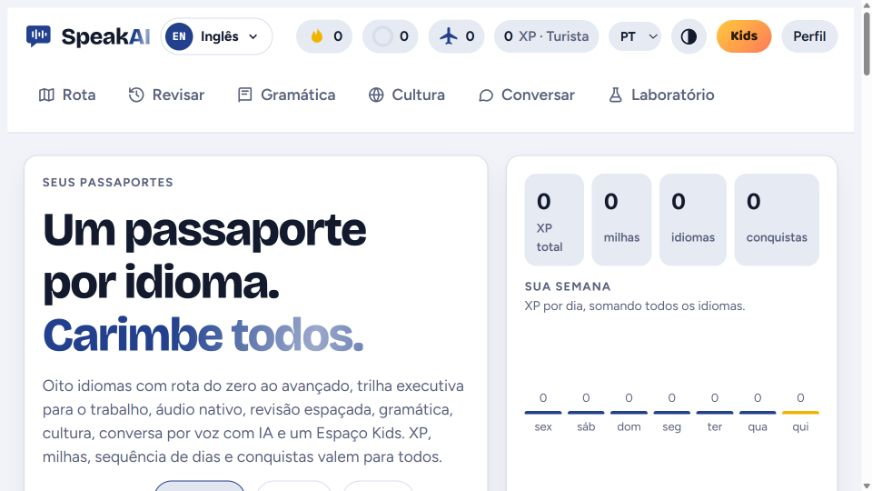
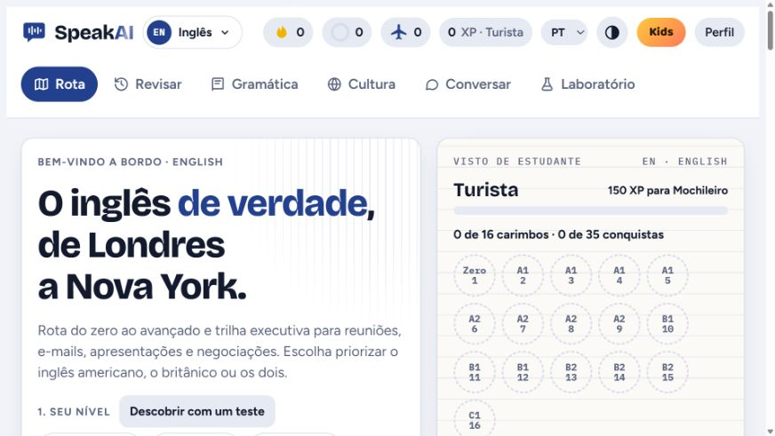
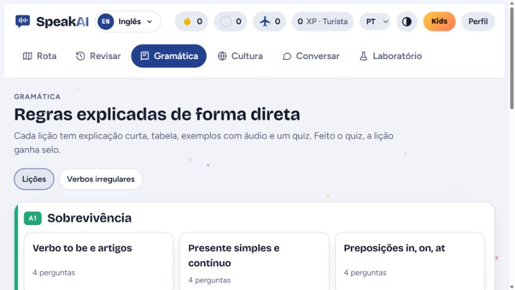

# SpeakAI · Aplicação de aprendizagem de idiomas

Interface web para organizar jornadas de estudo em oito idiomas, com trilha executiva, gramática, revisão e gamificação.

**Tecnologias:** JavaScript · HTML · CSS · Node.js para o endpoint de IA.

[Código completo — repositório privado](https://github.com/matosluan93/speakai-projeto) · [Projeto do prompt](../../prompts/speakai/)

## Problema e solução

Reunir estudo geral de idiomas e situações profissionais em uma jornada organizada. O front-end oferece seleção de idioma, rota de aprendizagem, gramática e conteúdos executivos, com progresso salvo no navegador.

## Demonstração visual

Capturas reais da implementação local, em 29/10/2026, sem dados pessoais.

### Seleção de idiomas

### Jornada de inglês

### Gramática

## Evidência de testes

Em **5 de novembro de 2026**, o build local concluiu com os **8 pacotes de idioma**. Os roteiros do projeto foram executados no Chromium com Playwright.

| Verificação | Resultado |
| :--- | :--- |
| Navegação e exercícios | 8 cursos em 3 idiomas de interface. O roteiro percorreu 240 unidades na interface em português, além de gramática, revisão, cultura e Espaço Kids. Houve um erro de resolução de endereço ao carregar um recurso no navegador. |
| Tutores de conversação | 6 combinações de tutor e curso em espanhol, japonês e português registraram o prompt e a configuração de voz esperados, com provedor simulado. |
| Chat pelo endpoint local | Sem chave, a interface exibiu o aviso de configuração. Com chave fictícia e Anthropic simulada, exibiu a resposta de teste. Os dois casos terminaram sem exceções JavaScript na página. |

A execução mede os fluxos da aplicação. A qualidade de respostas de um modelo real, a integração hospedada e a fala captada por microfone ficaram fora do teste.

## Estágio e limites

Build local executado e interface verificada no navegador. A conversa com IA depende da configuração da chave de API no servidor e não foi validada com um provedor real nesta sessão. Certificados e pontuações fazem parte da experiência do aplicativo; não representam certificação oficial de proficiência.

[Todas as aplicações](../) · [Portfólio](../../README.md)
