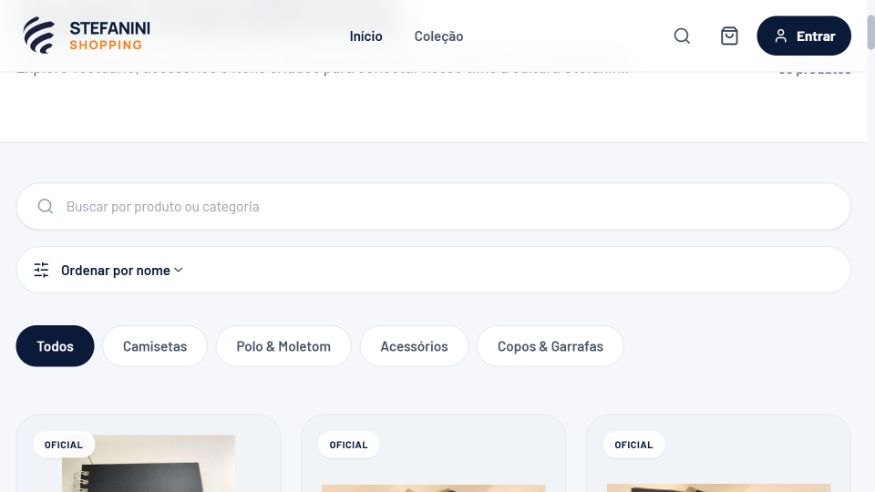
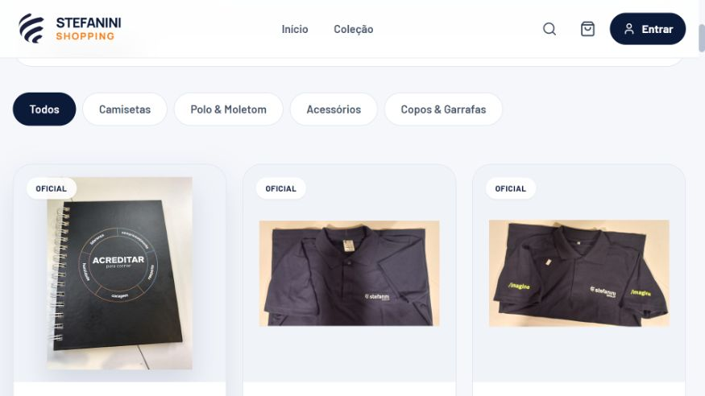

# Stefanini Shopping

Estudo de caso sanitizado de uma aplicação de e-commerce corporativo voltada à apresentação e evolução de uma loja interna de produtos institucionais.

> O código-fonte e os ativos corporativos permanecem em repositório privado. Esta página documenta somente competências e funcionalidades não confidenciais e não representa um produto oficialmente lançado.

## Demonstração visual

Capturas reais do front-end em execução local, em 29/10/2026, com catálogo local e sem credenciais de produção. Os textos comerciais, preços, indicadores e fluxos exibidos fazem parte do protótipo visual; não representam uma operação comercial homologada. O código-fonte permanece privado.

### Página inicial

### Catálogo

## Problema abordado

Estruturar uma experiência de compra mais profissional, responsiva e coerente com uma marca global, organizando catálogo, imagens, variações e jornada de compra sem impedir a execução local durante o desenvolvimento.

## Funcionalidades confirmadas

- Página inicial responsiva com identidade visual e animações de interface.
- Catálogo local com 33 produtos e imagens associadas.
- Busca, filtros, categorias e ordenação.
- Seleção de cor e tamanho conforme as variantes disponíveis.
- Carrinho, resumo do pedido e checkout demonstrativo.
- Telas de login, pedidos e administração preparadas para integrações futuras.
- Internacionalização em português, inglês e espanhol latino-americano.
- Seleção de país e apresentação estimada de valores em moedas locais.
- Experiência acessível com rótulos localizados e suporte a redução de movimento.

## Tecnologias utilizadas

- Next.js 14 e React 18.
- TypeScript 5.
- Tailwind CSS 3.
- Lucide React.
- JSON local para catálogo e variantes no modo de desenvolvimento.
- API interna de cotação com fallback local para conversão estimada de moedas.
- Estruturas de cliente preparadas para Supabase, mantidas sem conexão pessoal ativa.
- Git e GitHub para controle de versão em repositório privado.

## Competências demonstradas

- Levantamento e refinamento de requisitos de negócio.
- Arquitetura de informação e UX para e-commerce.
- Design responsivo e motion design aplicado à interface.
- Modelagem de produtos, categorias, cores, tamanhos e estoque.
- Internacionalização, tradução de interface e localização monetária.
- Organização de ativos visuais e proteção de arquivos de ambiente.
- Documentação clara de escopo, limitações e integrações planejadas.

## Limitações e próximos passos

O fluxo atual não comprova operação produtiva de pagamento, cálculo e contratação de frete, autenticação corporativa pelo Microsoft Entra ID, persistência em backend corporativo, baixa real de estoque, envio de e-mails ou emissão fiscal por TOTVS/SEFAZ. Essas capacidades permanecem como integrações planejadas e dependem de arquitetura, credenciais, homologação, segurança e aprovação da empresa.

As conversões monetárias são apenas estimativas de apresentação. O valor final, tributos, disponibilidade e regras de venda internacional exigem definição corporativa.

## Privacidade e propriedade intelectual

Este estudo não publica código, fotografias internas, dados de colaboradores, credenciais, documentos fiscais, regras comerciais confidenciais ou informações de infraestrutura. Qualquer divulgação adicional depende de autorização formal da Stefanini.

## Status

Front-end funcional para execução e demonstração local. Verificação estática de TypeScript concluída; integrações produtivas pendentes.

