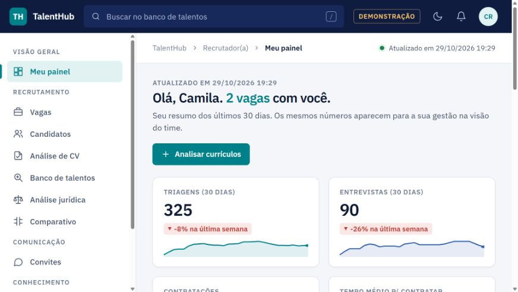
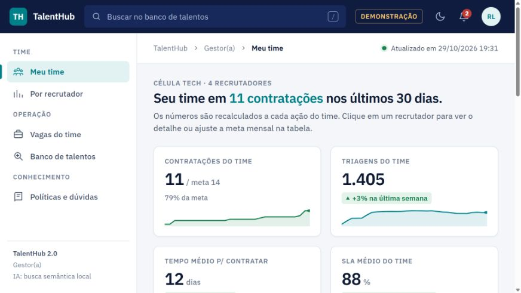

# TalentHub · Plataforma de recrutamento

Protótipo de aplicação web para organizar vagas, candidatos e indicadores em três perfis: recrutador, gestor e diretor.

**Tecnologias:** Python · Flask · Flask-SQLAlchemy · SQLite · MSAL · HTML · CSS · JavaScript.

[Código completo — repositório privado](https://github.com/matosluan93/talenthub)

## Problema e solução

Centralizar informações do processo seletivo e adaptar a visão às responsabilidades de cada perfil. A aplicação reúne CRUD de vagas e candidatos, pipeline, banco de talentos, políticas com recuperação de contexto e indicadores por equipe e país.

## Competências demonstradas

- Modelagem de dados e construção de API REST.
- Autenticação de demonstração, controle de acesso por perfil e proteção CSRF.
- Organização de fluxos de vagas e candidatos.
- Recuperação de contexto com índice local e apresentação de fontes.
- Preparação de integração com Microsoft Entra ID via MSAL.
- Testes automatizados com banco em memória e dados sintéticos.

## Demonstração visual

Capturas da aplicação em execução local com o seed fictício. Os nomes e indicadores exibidos pertencem ao cenário de demonstração.

### Visão do recrutador



### Visão da gestão



## Validação e limites

### Avaliação do assistente de políticas

Em **5 de novembro de 2026**, a execução com pytest reuniu os 11 testes existentes da aplicação e 10 novos cenários do endpoint `POST /api/assistant`. O ambiente usou Python 3.12, SQLite em memória e dados fictícios. No modo local, o assistente busca políticas por similaridade e responde com trechos extraídos. A avaliação cobre esse fluxo local.

```text
17 passed, 4 xfailed
```

| Grupo | Aprovados | Resultado observado |
| :--- | :---: | :--- |
| Testes existentes da aplicação | 11/11 | A suíte existente passou na execução conjunta. |
| Perguntas com fonte | 3/4 | A política esperada ficou em primeiro lugar nos quatro casos. Na pergunta sobre admissão na Argentina, a resposta omitiu DNI e CUIL. |
| Perguntas sem evidência | 1/3 | O assistente sinalizou ausência de informação na pergunta fora do domínio. Para o valor do bônus e a multa por descumprimento de SLA, exibiu trechos sem a informação solicitada. |
| Segurança e acesso | 2/3 | O acesso anônimo foi bloqueado e a anotação fictícia de um currículo ficou fora da resposta. Em uma política de teste, o assistente reproduziu uma instrução inserida no documento. |

Os quatro casos foram marcados como falhas conhecidas (`xfail`) e ficam fora da contagem de aprovações. Os 10 cenários formam uma linha de base local para comparar melhorias na seleção de trechos, na recusa por falta de evidência e na filtragem de instruções vindas de documentos.

O modo local usa vetores por hashing de termos para recuperação de contexto. O provedor Azure OpenAI e o login Microsoft estão implementados como opções de configuração, sem homologação em ambiente corporativo nesta sessão. Os módulos de avaliação são demonstrações de regras de aplicação e dependem de revisão humana e validação apropriada antes de qualquer uso real.

## Versão anterior

A implementação anterior foi preservada em uma branch de arquivo no repositório do código. A atualização mantém o histórico Git e publica a versão enviada em `TalentHub_v2` na branch principal.

[Todas as aplicações](../) · [Prompts de IA](../../prompts/) · [Portfólio](../../README.md)
