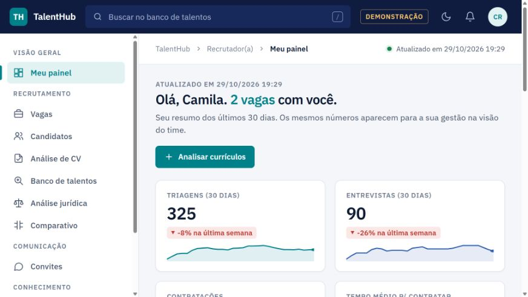
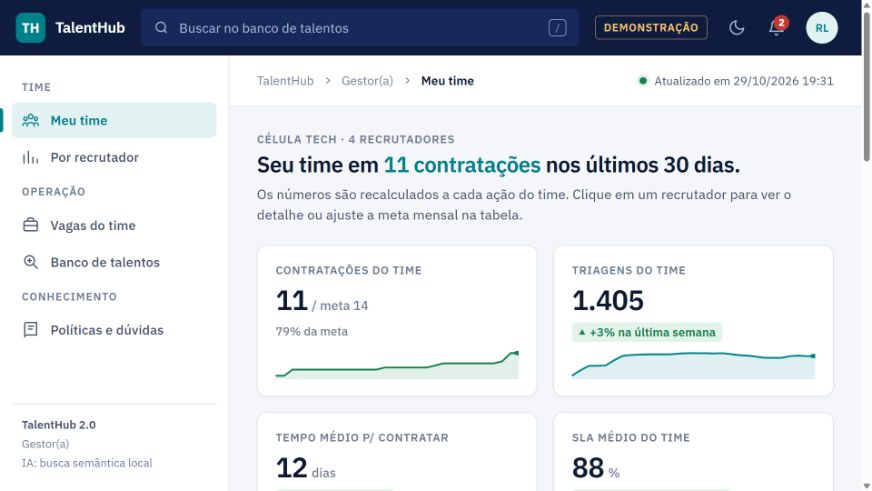

# TalentHub v2 · Plataforma de recrutamento

Protótipo de aplicação web para organizar vagas, candidatos e indicadores em três perfis: recrutador, gestor e diretor.

**Tecnologias:** Python · Flask · Flask-SQLAlchemy · SQLite · MSAL · HTML · CSS · JavaScript.

[Código completo — repositório privado](https://github.com/matosluan93/talenthub)

## Problema e solução

Centralizar informações do processo seletivo e adaptar a visão às responsabilidades de cada perfil. A aplicação reúne CRUD de vagas e candidatos, pipeline, banco de talentos, políticas com recuperação de contexto e indicadores por equipe e país.

## Competências demonstradas

- Modelagem de dados e construção de API REST.
- Autenticação de demonstração, controle de acesso por perfil e proteção CSRF.
- Organização de fluxos de vagas e candidatos.
- Recuperação de contexto com índice local e apresentação de fontes.
- Preparação de integração com Microsoft Entra ID via MSAL.
- Testes automatizados com banco em memória e dados sintéticos.

## Demonstração visual

Capturas da aplicação em execução local com o seed fictício. Os nomes e indicadores exibidos pertencem ao cenário de demonstração.

### Visão do recrutador

### Visão da gestão

## Validação e limites

11 testes automatizados passaram em execução local com Python 3.12, em 29/10/2026. A suíte usa dados de exemplo e banco SQLite em memória.

O modo local usa vetores por hashing de termos para recuperação de contexto. O provedor Azure OpenAI e o login Microsoft estão implementados como opções de configuração, sem homologação em ambiente corporativo nesta sessão. Os módulos de avaliação são demonstrações de regras de aplicação e dependem de revisão humana e validação apropriada antes de qualquer uso real.

## Versão anterior

A implementação anterior foi preservada em uma branch de arquivo no repositório do código. A atualização mantém o histórico Git e publica a versão enviada em `TalentHub_v2` na branch principal.

[Todas as aplicações](../) · [Prompts de IA](../../prompts/) · [Portfólio](../../README.md)
