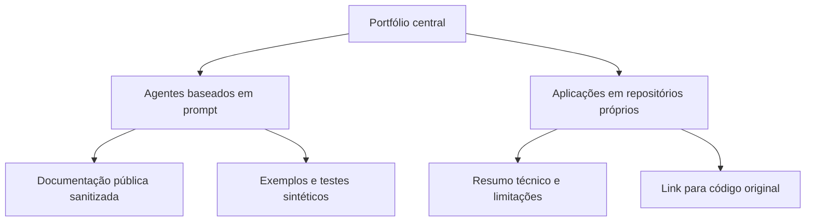

# Arquitetura do portfólio

O repositório central funciona como camada de apresentação. Aplicações com repositório próprio preservam seu histórico e recebem aqui apenas uma página técnica e um link.

